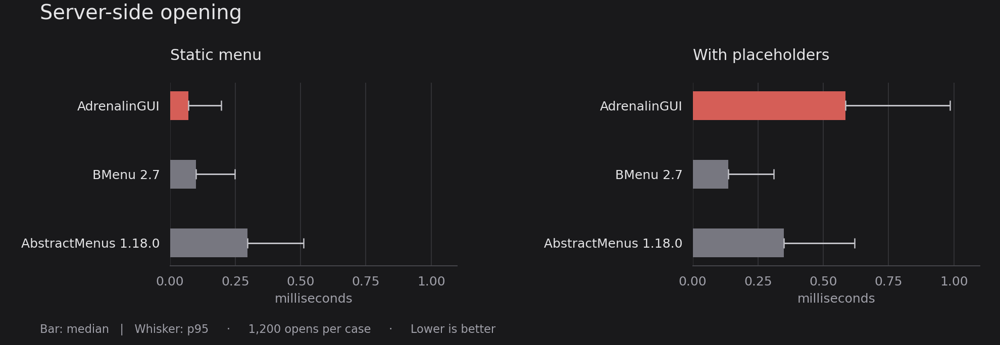
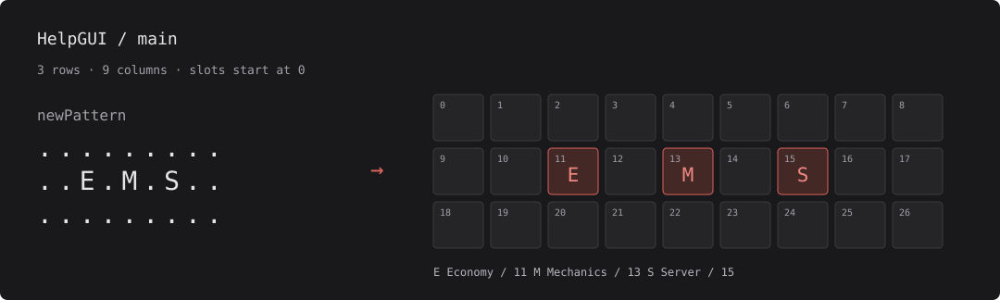

# AdrenalinGUI

Kotlin API for inventory menus in Minecraft plugins

[English](README.md) · [Русский](README.ru.md)


## Write a menu where your plugin logic lives

Define a layout with characters, attach items, and handle clicks in Kotlin. Use a single surface for a simple window or keep a help hub and its categories together in one multi-page class.

- **Readable layouts** — nine characters per row; repeated symbols fill multiple slots.
- **Optional PlaceholderAPI** — viewer-specific values in titles, item names, and lore, resolved on every open.
- **MiniMessage throughout** — titles, names, and lore accept tags, hex colors, and gradients.
- **Named pages** — `page("economy")` and `openPage("economy")`, with independent page caches.
- **Explicit lifecycle** — `onOpen` and `onClose` for every successfully opened session.
- **Cached prototypes** — the DSL and item metadata are built once per cache entry; each open gets a separate inventory and item copies.
- **Direct plugin integration** — call your own services from Kotlin click handlers. No command strings are required for your own plugin logic.

AdrenalinGUI is installed as a separate server plugin. This public build uses Paper/Adventure directly and bundles its Kotlin runtime.

## Requirements

| Component | Requirement |
| --- | --- |
| Java | 21 |
| Server | Paper 1.21.11 or an API-compatible fork; UniverseSpigot is the development target |
| Kotlin compiler | Project uses 2.5.0-Beta2; use this version when building the examples or a compatible compiler |
| Build tool | Gradle Wrapper included, 9.6.0 |
| Extra server plugins | None required; PlaceholderAPI and its relevant expansions are optional |
| Folia | Not supported by the current main-thread scheduler |

The build, unit tests and local bot benchmark cover the published scenarios below. These measurements are not a server-capacity test; compatibility beyond the target version is not claimed.

## Build and install

```bash
git clone https://github.com/chotaktota/AdrenalinGUI.git
cd AdrenalinGUI
./gradlew clean build publishToMavenLocal
```

Windows:

```powershell
.\gradlew.bat clean build publishToMavenLocal
```

Copy `build/libs/AdrenalinGUI-1.0-SNAPSHOT.jar` into the server's `plugins/` directory and restart the server.

In your own plugin's `build.gradle.kts`:

```kotlin
repositories {
    mavenLocal()
}

dependencies {
    compileOnly("dev.aethereal:AdrenalinGUI:1.0-SNAPSHOT")
}
```

These coordinates refer to the artifact you just published locally. A hosted Maven repository or JitPack release is not configured.

Add to your plugin's `plugin.yml`:

```yaml
depend: [AdrenalinGUI]
```

For a `paper-plugin.yml` consumer:

```yaml
dependencies:
  server:
    AdrenalinGUI:
      load: BEFORE
      required: true
      join-classpath: true
```

## Quick start

```kotlin
import dev.aethereal.agui.surface.SingleGUISurface
import org.bukkit.Material
import org.bukkit.plugin.java.JavaPlugin

class QuickStartGUI(plugin: JavaPlugin) : SingleGUISurface(3, plugin) {
    override fun onUpdateNodes() {
        with(newPattern("""
            .........
            ....X....
            .........
        """.trimIndent())) {
            title("<red>Welcome")
            iconAt(pos('X')) {
                type(Material.ENDER_EYE)
                name("<white>Explore the server")
                loreLine("<gray>Your menu. Your Kotlin code.")
                loreLine("<green>Click to close")
                glow()
                allFlags()
                onClick { close() }
            }
        }
    }
}
```

Create the instance once in your plugin and reuse it:

```kotlin
val menu = QuickStartGUI(this)
menu.open(player)
```

A pattern must contain the declared number of rows, each exactly nine characters long. A dot is an empty slot. `pos('X')` returns every matching slot; `iconAt(13)` addresses a slot directly using a zero-based index.

## One menu, several pages

```kotlin
import dev.aethereal.agui.surface.MultiGUISurface
import org.bukkit.Material
import org.bukkit.plugin.java.JavaPlugin

class GuideGUI(plugin: JavaPlugin) : MultiGUISurface(1, plugin) {
    override fun onUpdateNodes() {
        page("main") {
            with(newPattern("....E....")) {
                title("<gold>Server guide")
                iconAt(pos('E')) {
                    type(Material.GOLD_INGOT)
                    name("<yellow>Economy")
                    onClick { openPage("economy") }
                }
            }
        }
        page("economy") {
            with(newPattern("....B....")) {
                title("<yellow>Economy")
                iconAt(pos('B')) {
                    type(Material.ARROW)
                    name("<yellow>Back")
                    onClick { openPage("main") }
                }
            }
        }
    }
}
```

`menu.open(player)` starts at `main`. `menu.open(player, "economy")` opens a section directly. Set another start page using the constructor's third argument; override a page's row count with `page("economy", rows = 6)`.

The full [HelpGUI example](src/test/kotlin/dev/aethereal/agui/example/HelpGUI.kt) contains a hub plus economy, mechanics, and server-information pages.

## PlaceholderAPI

Install PlaceholderAPI and the expansions your placeholders need. Without it, menus still open and placeholder tokens remain unchanged. Missing expansions also leave their unknown tokens unchanged.

```kotlin
title("<gold>Profile: %player_name%")
name("<white>%player_name%")
loreLine("<gray>Balance: <yellow>%vault_eco_balance%")
```

These calls belong in the title or item blocks shown above. The complete [PlayerProfileGUI](src/test/kotlin/dev/aethereal/agui/example/PlayerProfileGUI.kt) example compiles with the project.

Resolution runs on the main thread for the player opening the menu, before MiniMessage parsing. Placeholder values containing MiniMessage tags are formatted too; legacy color codes are also supported, including values returned by expansions. Placeholder values are read afresh; a bounded shared cache reuses components with identical resolved text. Identical source text is resolved only once within a single opening, and plain static text keeps its cached component.

Values refresh when the menu or page opens again. An already open inventory does not update automatically. See the [PlaceholderAPI usage documentation](https://wiki.placeholderapi.com/developers/using-placeholderapi/) for expansion requirements.

## Register once, open by name

```kotlin
import dev.aethereal.agui.AdrenalinGUI
import org.bukkit.plugin.java.JavaPlugin

val engine = JavaPlugin.getPlugin(AdrenalinGUI::class.java).engine
engine.menus.register("help", HelpGUI(this))
engine.open("help", player)
```

Registration is optional. `engine.menus.find("help")` returns a surface or null; `unregister("help")` removes its name and clears its cache. Already open sessions keep their snapshot until closed.

[HelpExamplePlugin.kt](src/test/kotlin/dev/aethereal/agui/example/HelpExamplePlugin.kt) shows command wiring. Its plugin descriptor needs:

```yaml
name: HelpExample
version: '1.0'
main: dev.aethereal.agui.example.HelpExamplePlugin
api-version: '1.21.11'
depend: [AdrenalinGUI]
commands:
  helpui:
    description: Open the server guide
```

These example classes compile during tests; they are not bundled into the framework JAR.

## Lifecycle, clicks, and caching

For a single surface, override `onOpen(player: Player)` / `onClose(player: Player)`. For a multi-page surface, override `onOpen(player: Player, page: String)` / `onClose(player: Player, page: String)`.

A page transition invokes the old page's close hook and the new page's open hook after successful opening. A cancelled open does not invoke that new page's hooks. If Bukkit closes the previous window before another plugin cancels the new open, the previous window is not restored.

| Operation | Behavior |
| --- | --- |
| First open | Build the layout, text, and item prototypes |
| Repeated open | Clone cached prototypes; resolve placeholder-bearing text for this viewer |
| `menu.invalidateCache()` | Rebuild on the next open; existing sessions keep their snapshot |
| `multi.invalidateCache("economy")` | Rebuild that page on its next open |
| Owner plugin disabled | Close its sessions, remove registrations, and clear tracked caches |

Reuse menu instances. Creating a new menu object for every click creates a new cache too. Cached layouts are shared between viewers: do not capture a specific player's data in a shared cached layout. Placeholder text is resolved separately for each viewer on every open.

Click handlers expose `player`, `slot`, `click`, `isLeftClick`, `isRightClick`, and `isShiftClick`; multi-page clicks also expose `page`. A click action runs on the next main-thread tick, allowing inventory transitions. Additional clicks before it runs are coalesced; closing the inventory first discards the action.

All item movement and inventory dragging are blocked while a framework menu is open, including the lower inventory. Menu operations must run on the main thread. When opening another menu from an `onClose` hook, schedule that open for the next tick.

There are no periodic refresh tasks or automatic player scans. This describes the implementation, not a performance ranking against other plugins.

## BMenu & AbstractMenus

These are the specific API differences in the checked releases, not a claim that other plugins cannot implement similar menus.

| AdrenalinGUI provides directly | BMenu 2.7 | AbstractMenus 1.18.0 |
| --- | --- | --- |
| Kotlin receiver DSL: `SingleGUISurface`, `newPattern`, `iconAt`, `onClick` | Java extension API and YAML; this Kotlin DSL is not provided | Java extension API and HOCON; this Kotlin DSL is not provided |
| Named pages and `openPage` in one `MultiGUISurface` class | No equivalent first-party surface/page DSL | No equivalent first-party surface/page DSL |
| Event-driven menu runtime without a repeating menu-update task | Menu loader runs a tick task | Menu manager runs an update task |

The practical difference is that layouts, page navigation and typed calls to your services stay in one Kotlin class. No custom config action or serializer is needed for an ordinary callback. Both alternatives have extension APIs, navigation, placeholders and caches; these are not exclusive AdrenalinGUI features.

Scope: [BMenu 2.7 source](https://github.com/By1337/BMenu/tree/2.7/src/main/java/dev/by1337/bmenu), [AbstractMenus 1.18.0 source](https://github.com/AbstractMenus/minecraft-plugin/tree/v1.18.0/src/main/java/ru/abstractmenus). Their current development branches may differ. AdrenalinGUI also needs no extra server plugin for its base API; BMenu requires BLib and PlaceholderAPI, while AbstractMenus has optional integrations.

## Measured performance

The tables below describe the version **before the placeholder optimization**. See dynamic icons for current cache behavior.

Measured on November 20, 2026: Paper 1.21.11 build 132, Java 21.0.11, i5-12400F, 16 GB RAM, Windows 11, JVM heap 1–2 GB. Eight bots ran on the same PC. All three plugins were loaded in one server and exercised sequentially in changing order.

Each window had 54 PAPER items, four lore lines and matching legacy colors. The second scenario added viewer-specific placeholders in the title, names and lore. After warmup, three rounds produced **1,200 opens and 1,200 actions per engine per scenario**. Bots verified 466,560 items including warmup.

### Server-side opening

Time from the public open API call until return, including closing/replacing the old window. Client network/render time is excluded. Lower is better.

| Engine | Static p50 / p95, ms | Placeholders p50 / p95, ms |
| --- | ---: | ---: |
| AdrenalinGUI | 0.070 / 0.197 | 0.586 / 0.985 |
| BMenu 2.7 | 0.100 / 0.247 | 0.136 / 0.310 |
| AbstractMenus 1.18.0 | 0.297 / 0.512 | 0.348 / 0.620 |



### Click-to-action delay

Time from receipt of an inventory click on the server until the same player command executes. This includes the engine's scheduling, not client network latency.

| Engine | Static p50 / p95, ms | Placeholders p50 / p95, ms |
| --- | ---: | ---: |
| AdrenalinGUI | 25.287 / 49.034 | 25.190 / 48.874 |
| BMenu 2.7 | 0.021 / 0.068 | 0.025 / 0.084 |
| AbstractMenus 1.18.0 | 0.025 / 0.094 | 0.023 / 0.064 |

AdrenalinGUI had the lowest static-menu median in this run, but was slower than both alternatives with placeholders. Its next-tick callback policy also produced about 25 ms median action delay; the other two executed the tested action in the click event. There is no overall “fastest” claim.

This is one workstation run, not a capacity/TPS benchmark. Round-to-round timings varied. JVM HTTP(S) downloads/update checks were blocked; BMenu's optional 1.7 compatibility bridge was unavailable, and its native 2.7 path was verified. Read the [method, limitations and reproduction steps](benchmarks/README.md), [raw samples](benchmarks/results/2026-11-20/samples.json), [per-round summary](benchmarks/results/2026-11-20/summary.json), and [environment](benchmarks/results/2026-11-20/environment.json).

### After optimization: approximate run with Rust open

Rust remained running (around 8 GiB). The same menus and eight bots produced 1,200 opens per case and all 7,200 action samples. All 466,560 item checks passed. This is an estimate under unrelated load, not a clean comparison against the original build.

| Engine | Static: p50 / p95, ms | Placeholders: p50 / p95, ms |
| --- | ---: | ---: |
| AdrenalinGUI | 0.158 / 0.414 | 0.217 / 0.559 |
| BMenu 2.7 | 0.177 / 0.441 | 0.206 / 0.597 |
| AbstractMenus 1.18.0 | 0.501 / 0.989 | 0.578 / 1.151 |

BMenu retains a slightly lower placeholder median; AdrenalinGUI has the lower p95. A roughly 5% median gap on a busy PC does not establish a stable advantage. AdrenalinGUI click latency remains around 25 ms because callbacks are safely deferred to the next tick.

[Raw samples](benchmarks/results/2026-11-20-loaded-v2/samples.json), [statistics](benchmarks/results/2026-11-20-loaded-v2/summary.json), [conditions and SHA-256](benchmarks/results/2026-11-20-loaded-v2/environment.json). A clean rerun without the game is still needed.

## Examples



| Example | What it shows |
| --- | --- |
| [QuickStartGUI](src/test/kotlin/dev/aethereal/agui/example/QuickStartGUI.kt) | A patterned single-page menu |
| [HelpGUI](src/test/kotlin/dev/aethereal/agui/example/HelpGUI.kt) | Four named pages and back buttons |
| [HelpExamplePlugin](src/test/kotlin/dev/aethereal/agui/example/HelpExamplePlugin.kt) | Registration and a player command |
| [PreviewGUI](src/test/kotlin/dev/aethereal/agui/example/PreviewGUI.kt) | The larger six-row layout |
| [DynamicEconomyGUI](src/test/kotlin/dev/aethereal/agui/example/DynamicEconomyGUI.kt) | Dynamic fields, refresh, economy and permission services |

## Project layout

```text
AdrenalinGUI.kt
engine/
  MenuEngine.kt
  MenuRegistry.kt
  MenuScheduler.kt
  cache/
  session/
surface/
  GUISurface.kt
  SingleGUISurface.kt
  MultiGUISurface.kt
  layout/
  item/
  animation/
command/
integration/
text/
listener/
```

## Current scope

Java inventory menus, named category pages, MiniMessage/legacy, optional PlaceholderAPI, dynamic icons with explicit refresh, tick-based animation, Vault economy, LuckPerms, click callbacks and lifecycle hooks are implemented.


Automatic list pagination, automatic polling of dynamic values, config loaders, native Bedrock forms, and resource-pack/client detection are not implemented.

Run `./gradlew test` for cache, pattern, page-registry, and lifecycle unit tests. Examples are compiled too; the published bot benchmark additionally checks the listed live-server scenarios.

## Feedback

Open an [issue](https://github.com/chotaktota/AdrenalinGUI/issues) with your Java/server version, a minimal menu class, and a reproducible description.

[Русская документация →](README.ru.md)

## MiniMessage and legacy together

Titles, names, lore and placeholder results accept MiniMessage mixed with legacy colors and decorations. Supported forms: `&a`, `§a`, `&l`, `&r`, `&#A1B2C3`, `&x&A&1&B&2&C&3` and their section-sign equivalents. Legacy color codes reset preceding decorations, matching legacy behavior. MM tag attributes, such as click URLs, are left intact.

```kotlin
title("&6Server <bold>guide</bold>")
name("&#55FFAA%player_name%")
loreLine("§7Balance: &e%vault_eco_balance%")
```

[Оформление и источники изображений](docs/assets/README.md)

## Conditional icon visibility

```kotlin
iconAt(pos('V')) {
    type(Material.DIAMOND)
    name("<gold>VIP")
    requirePermission("myplugin.vip")
    onClick { close() }
}
```

Use `visibleIf { player -> ... }` for custom conditions. When an icon declares several conditions, all must pass. Visibility is evaluated for each viewer when opening or refreshing the menu and when an animation updates the slot. Call `engine.refresh(player)` to update an already open menu after a permission change. Clicks require a displayed item and pass the same check again before the handler runs.

## Dynamic icons and refresh

```kotlin
iconAt(pos('B')) {
    type(Material.PAPER)
    dynamic { player ->
        val balance = engine.economy.balance(player)
        name("<gold>${engine.economy.format(balance)}")
        lore("&7Player: %player_name%", "<gray>Balance: $balance")
        glow(balance >= 100.0)
        if (balance >= 100.0) enchant(Enchantment.UNBREAKING, 1)
    }
    onClick {
        val result = engine.economy.withdraw(player, 100.0)
        if (result.success) refresh(slot)
    }
}
```

Here `engine` is `AdrenalinGUI.engine`; import `org.bukkit.Material` and `org.bukkit.enchantments.Enchantment`.
The `dynamic` callback runs on the server thread when opening or explicitly refreshing. Each pass starts with a separate copy of the original item. `lore(...)` replaces all lore; `name`, `glow`, `enchant` and `removeEnchant` affect that item only. Changes do not accumulate between passes.

Use `engine.refresh(player)` for all items, or `engine.refresh(player, 11, 13)` for zero-based slots. Click callbacks also expose `refresh()` and `refresh(slot)`. Refresh keeps the title, page and lifecycle hooks unchanged; reopen to change a title. No timers or player scans are scheduled.

Placeholder values are resolved for each open/refresh, with repeated tokens resolved once per pass. Parsed text and item metadata keep at most 16 result variants per element. Cache keys use the current result, so changed values need no cache invalidation. Dynamic callback results are never shared through the item cache. Fetch expensive database data in your own asynchronous service, then refresh on the server thread.

## Vault and LuckPerms

Install Vault plus an economy provider and/or LuckPerms as optional plugins. Their APIs are not bundled. Their placeholders still require PlaceholderAPI and the appropriate expansions.

```kotlin
val money = engine.economy
val balance = money.balance(player)
val affordable = money.has(player, 100.0)
val payment = money.withdraw(player, 100.0)
val refund = money.deposit(player, 100.0)
val formatted = money.format(balance)

val rights = engine.permissions
val allowed = rights.hasPermission(player, "shop.vip") == true
val group = rights.primaryGroup(player.uniqueId)
val groups = rights.groups(player)
val prefix = rights.prefix(player)
val suffix = rights.suffix(player)
rights.setPermission(player.uniqueId, "shop.vip", duration = Duration.ofDays(7))
rights.unsetPermission(player.uniqueId, "shop.old")
rights.addGroup(player.uniqueId, "vip", duration = Duration.ofDays(7))
rights.removeGroup(player.uniqueId, "old")
```

Import `java.time.Duration`. Amounts must be finite and nonnegative. Check `Transaction.success` even after `has`; providers can reject a transaction. Access without the required plugin/provider fails with a diagnostic error.

LuckPerms writes return `CompletableFuture<Void>`. Never block the server thread with `join()` or `get()`. Handle failures and schedule Bukkit work, including refresh, on the server thread from continuations. Writes affect the named global nodes and preserve contextual nodes; removing a direct permission does not remove inherited permissions. Group validation and purchase rules belong to your plugin. A withdrawal and an asynchronous group assignment are separate operations.

Upstream APIs: [Vault Economy](https://github.com/MilkBowl/VaultAPI/blob/master/src/main/java/net/milkbowl/vault/economy/Economy.java), [LuckPerms UserManager](https://github.com/LuckPerms/LuckPerms/blob/master/api/src/main/java/net/luckperms/api/model/user/UserManager.java). Add compileOnly `net.luckperms:api:5.4` to your plugin when using `permissions.api`, `user` or `loadUser` directly.

## Tick-based animation

Declare one timeline inside `with(newPattern(...))`:

```kotlin
animation {
    at(0) { hide(pos('X')) }
    at(10) { show(pos('X')) }
    at(20) {
        change(pos('X')) { player ->
            name("<gold>${player.name}")
            lore("&7Баланс: %vault_eco_balance%")
            glow()
        }
    }
    at(30) {
        set(pos('X')) {
            type(Material.EMERALD)
            name("<green>Готово")
            onClick { close() }
        }
    }
    loop(60)
}
```

`at(10)` is an absolute server-tick offset from opening, not a delay from the previous step. At 20 TPS this is about half a second; lower TPS increases wall-clock time. Tick 0 runs immediately after `onOpen`; later frames run on the server thread. Steps sharing a tick merge in declaration order.

- `set(slot)` / `set(pos('X'))` replaces the icon using the normal DSL, including `dynamic` and `onClick`. It becomes visible and previous animation edits are cleared.
- `hide(...)` hides the item and disables its click handler while retaining its icon.
- `show(...)` restores the latest icon, its edits and current placeholder values.
- `change(...) { player -> ... }` edits name, lore, glow and enchantments. Use `set` to replace the material. Changing an empty slot does nothing.

Without `loop`, the timeline runs once and leaves its final state. `loop(60)` repeats every 60 ticks and must exceed the last step tick. Step 10 of the next cycle runs at tick 70. Cycles retain state; use `set` at tick 0 if you need to reset an item.

Refresh preserves animation replacements, hidden slots and edits. Saved `change` callbacks are reapplied on refresh, so keep purchases and other side effects out of them. Text accepts MiniMessage, legacy and PlaceholderAPI. Each open window has independent state and progress; shared cached prototypes remain unchanged.

The engine maintains at most one pending scheduler callback for its queue of frames and clicks. An empty queue schedules no background work. Only affected slots are rendered; unchanged items are not set again. There are no online-player scans. Closing, page changes, logout and plugin shutdown cancel pending work. A frame exception closes the window with a diagnostic. A queued click is discarded if its slot changes before dispatch.

Compilable example: [AnimatedGUI](src/test/kotlin/dev/aethereal/agui/example/AnimatedGUI.kt). Earlier performance measurements describe builds before animations were added, not frame playback cost.

## /guis info command

Requires `adrenalingui.admin` (operators by default).

| Command | Action |
| --- | --- |
| `/guis` | Show usage |
| `/guis info` | List ten registered menus with owner plugin and menu type |
| `/guis info --page <number>` | Show another list page |
| `/guis info <menu>` | Show owner/version, plugin state, type, class and menu size |

Multi-page menus also show their initial page. The command opens no inventory, invalidates no cache and builds no menu templates. Only `engine.menus.register(id, menu)` registrations appear. IDs support tab completion; use IDs without spaces. Console execution is supported.

`engine.menus.entries()` returns an independent registry snapshot. Changing it cannot alter registrations. Call it on the server thread.

## Package changes

MenuEngine and MenuRegistry moved to `dev.aethereal.agui.engine`. Update imports for explicitly referenced DSL types using the package layout above.
