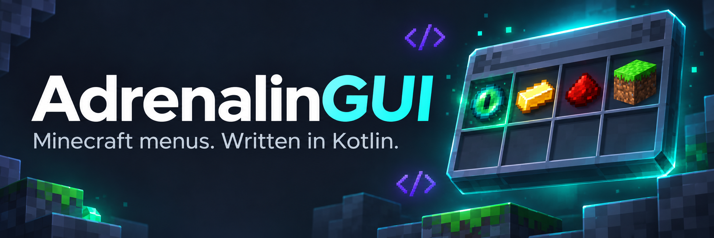
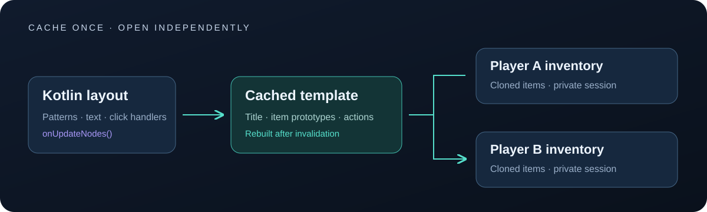

<div align="center">



<p><strong>A Kotlin DSL for inventory menus inside your Minecraft plugins.</strong></p>

<p>


</p>

**English** · [Русский](README.ru.md)

[Quick start](#quick-start) · [Pages](#one-menu-several-pages) · [Comparison](#bmenu--abstractmenus) · [Examples](#examples) · [Requirements](#requirements)

</div>

> The cover is an AI-generated concept illustration, not an in-game screenshot. The project is in early development; the API may change.

## Write a menu where your plugin logic lives

Define a layout with characters, attach items, and handle clicks in Kotlin. Use a single surface for a simple window or keep a help hub and its categories together in one multi-page class.

- **Readable layouts** — nine characters per row; repeated symbols fill multiple slots.
- **Optional PlaceholderAPI** — viewer-specific values in titles, item names, and lore, resolved on every open.
- **MiniMessage throughout** — titles, names, and lore accept tags, hex colors, and gradients.
- **Named pages** — `page("economy")` and `openPage("economy")`, with independent page caches.
- **Explicit lifecycle** — `onOpen` and `onClose` for every successfully opened session.
- **Cached prototypes** — the DSL and item metadata are built once per cache entry; each open gets a separate inventory and item copies.
- **Direct plugin integration** — call your own services from Kotlin click handlers. No command strings are required for your own plugin logic.

AdrenalinGUI is installed as a separate server plugin. This public build uses Paper/Adventure directly and bundles its Kotlin runtime.

## Requirements

| Component | Requirement |
| --- | --- |
| Java | 21 |
| Server | Paper 1.21.11 or an API-compatible fork; UniverseSpigot is the development target |
| Kotlin compiler | Project uses 2.5.0-Beta2; use this version when building the examples or a compatible compiler |
| Build tool | Gradle Wrapper included, 9.6.0 |
| Extra server plugins | None required; PlaceholderAPI and its relevant expansions are optional |
| Folia | Not supported by the current main-thread scheduler |

The build and unit tests are checked locally. An automated server integration test and a multiplayer load benchmark are not included; compatibility beyond the target version is not claimed.

## Build and install

```bash
git clone https://github.com/chotaktota/AdrenalinGUI.git
cd AdrenalinGUI
./gradlew clean build publishToMavenLocal
```

Windows:

```powershell
.\gradlew.bat clean build publishToMavenLocal
```

Copy `build/libs/AdrenalinGUI-1.0-SNAPSHOT.jar` into the server's `plugins/` directory and restart the server.

In your own plugin's `build.gradle.kts`:

```kotlin
repositories {
    mavenLocal()
}

dependencies {
    compileOnly("dev.aethereal:AdrenalinGUI:1.0-SNAPSHOT")
}
```

These coordinates refer to the artifact you just published locally. A hosted Maven repository or JitPack release is not configured.

Add to your plugin's `plugin.yml`:

```yaml
depend: [AdrenalinGUI]
```

For a `paper-plugin.yml` consumer:

```yaml
dependencies:
  server:
    AdrenalinGUI:
      load: BEFORE
      required: true
      join-classpath: true
```

## Quick start

```kotlin
import dev.aethereal.agui.surface.SingleGUISurface
import org.bukkit.Material
import org.bukkit.plugin.java.JavaPlugin

class QuickStartGUI(plugin: JavaPlugin) : SingleGUISurface(3, plugin) {
    override fun onUpdateNodes() {
        with(newPattern("""
            .........
            ....X....
            .........
        """.trimIndent())) {
            title("<gradient:#55FFAA:#55AAFF>Welcome</gradient>")
            iconAt(pos('X')) {
                type(Material.ENDER_EYE)
                name("<white>Explore the server")
                loreLine("<gray>Your menu. Your Kotlin code.")
                loreLine("<green>Click to close")
                glow()
                allFlags()
                onClick { close() }
            }
        }
    }
}
```

Create the instance once in your plugin and reuse it:

```kotlin
val menu = QuickStartGUI(this)
menu.open(player)
```

A pattern must contain the declared number of rows, each exactly nine characters long. A dot is an empty slot. `pos('X')` returns every matching slot; `iconAt(13)` addresses a slot directly using a zero-based index.

## One menu, several pages

```kotlin
import dev.aethereal.agui.surface.MultiGUISurface
import org.bukkit.Material
import org.bukkit.plugin.java.JavaPlugin

class GuideGUI(plugin: JavaPlugin) : MultiGUISurface(1, plugin) {
    override fun onUpdateNodes() {
        page("main") {
            with(newPattern("....E....")) {
                title("<gold>Server guide")
                iconAt(pos('E')) {
                    type(Material.GOLD_INGOT)
                    name("<yellow>Economy")
                    onClick { openPage("economy") }
                }
            }
        }
        page("economy") {
            with(newPattern("....B....")) {
                title("<yellow>Economy")
                iconAt(pos('B')) {
                    type(Material.ARROW)
                    name("<yellow>Back")
                    onClick { openPage("main") }
                }
            }
        }
    }
}
```

`menu.open(player)` starts at `main`. `menu.open(player, "economy")` opens a section directly. Set another start page using the constructor's third argument; override a page's row count with `page("economy", rows = 6)`.

The full [HelpGUI example](src/test/kotlin/dev/aethereal/agui/example/HelpGUI.kt) contains a hub plus economy, mechanics, and server-information pages.

## PlaceholderAPI

Install PlaceholderAPI and the expansions your placeholders need. Without it, menus still open and placeholder tokens remain unchanged. Missing expansions also leave their unknown tokens unchanged.

```kotlin
title("<gold>Profile: %player_name%")
name("<white>%player_name%")
loreLine("<gray>Balance: <yellow>%vault_eco_balance%")
```

These calls belong in the title or item blocks shown above. The complete [PlayerProfileGUI](src/test/kotlin/dev/aethereal/agui/example/PlayerProfileGUI.kt) example compiles with the project.

Resolution runs on the main thread for the player opening the menu, before MiniMessage parsing. Placeholder values containing MiniMessage tags are formatted too; legacy color codes are not converted by this text pipeline. Player values are never stored in the shared menu cache. Identical source text is resolved only once within a single opening, and plain static text keeps its cached component.

Values refresh when the menu or page opens again. An already open inventory does not update automatically. See the [PlaceholderAPI usage documentation](https://wiki.placeholderapi.com/developers/using-placeholderapi/) for expansion requirements.

## Register once, open by name

```kotlin
import dev.aethereal.agui.AdrenalinGUI
import org.bukkit.plugin.java.JavaPlugin

val engine = JavaPlugin.getPlugin(AdrenalinGUI::class.java).engine
engine.menus.register("help", HelpGUI(this))
engine.open("help", player)
```

Registration is optional. `engine.menus.find("help")` returns a surface or null; `unregister("help")` removes its name and clears its cache. Already open sessions keep their snapshot until closed.

[HelpExamplePlugin.kt](src/test/kotlin/dev/aethereal/agui/example/HelpExamplePlugin.kt) shows command wiring. Its plugin descriptor needs:

```yaml
name: HelpExample
version: '1.0'
main: dev.aethereal.agui.example.HelpExamplePlugin
api-version: '1.21.11'
depend: [AdrenalinGUI]
commands:
  helpui:
    description: Open the server guide
```

These example classes compile during tests; they are not bundled into the framework JAR.

## Lifecycle, clicks, and caching



For a single surface, override `onOpen(player: Player)` / `onClose(player: Player)`. For a multi-page surface, override `onOpen(player: Player, page: String)` / `onClose(player: Player, page: String)`.

A page transition invokes the old page's close hook and the new page's open hook after successful opening. A cancelled open does not invoke that new page's hooks. If Bukkit closes the previous window before another plugin cancels the new open, the previous window is not restored.

| Operation | Behavior |
| --- | --- |
| First open | Build the layout, text, and item prototypes |
| Repeated open | Clone cached prototypes; resolve placeholder-bearing text for this viewer |
| `menu.invalidateCache()` | Rebuild on the next open; existing sessions keep their snapshot |
| `multi.invalidateCache("economy")` | Rebuild that page on its next open |
| Owner plugin disabled | Close its sessions, remove registrations, and clear tracked caches |

Reuse menu instances. Creating a new menu object for every click creates a new cache too. Cached layouts are shared between viewers: do not capture a specific player's data in a shared cached layout. Placeholder text is resolved separately for each viewer on every open.

Click handlers expose `player`, `slot`, `click`, `isLeftClick`, `isRightClick`, and `isShiftClick`; multi-page clicks also expose `page`. A click action runs on the next main-thread tick, allowing inventory transitions. Additional clicks before it runs are coalesced; closing the inventory first discards the action.

All item movement and inventory dragging are blocked while a framework menu is open, including the lower inventory. Menu operations must run on the main thread. When opening another menu from an `onClose` hook, schedule that open for the next tick.

There are no periodic refresh tasks or automatic player scans. This describes the implementation, not a performance ranking against other plugins.

## BMenu & AbstractMenus

These tools have different primary workflows. AdrenalinGUI puts a small typed DSL inside your plugin; BMenu documents YAML-based menus; AbstractMenus documents HOCON-based menus. Both alternatives also offer extension APIs — the comparison does not claim otherwise.

| Capability / workflow | AdrenalinGUI today | BMenu | AbstractMenus |
| --- | --- | --- | --- |
| Primary menu definition | Kotlin classes and callbacks | YAML files | HOCON files |
| Logic for your own plugin services | Direct Kotlin calls | Config actions; extension API for custom logic | Config actions; extension API for custom logic |
| Multi-section guide | Named pages within one class | Menu navigation actions | Menu navigation actions |
| Text colors | MiniMessage | MiniMessage and legacy formats | MiniMessage and legacy formats |
| Ready-made animations / updates | Not implemented | Documented | Documented |
| Built-in placeholder integration | Optional PlaceholderAPI | PlaceholderAPI | PlaceholderAPI |
| Editing menus without recompiling your plugin | Not implemented | Reloadable configs | Reloadable configs |
| Built-in economy/rules/action catalogue | Write your own Kotlin handlers | Configured actions and conditions | Configured rules and actions |

The advantage here is control over your plugin's Kotlin code and an explicit cache lifecycle. The tradeoff is fewer ready-made server-administration features. We do not claim exclusive support for pages or caching, or better performance without equivalent benchmarks.

For a small “close” button, the styles look like this:

**BMenu — YAML**, authored using the [official first-menu syntax](https://wiki.bdev.space/bmenu/start):

```yaml
id: guide:home
size: 9
title: '<gold>Guide'
items:
  exit:
    slot: 4
    material: barrier
    name: '<red>Close'
    on_click:
      - close: ''
```

**AbstractMenus — HOCON**, authored using the [official creation guide](https://abstractmenus.github.io/docs/en/start/how-to/):

```hocon
title: "Guide"
size: 1
items: [
  {
    slot: 4
    material: BARRIER
    name: "Close"
    click { closeMenu: true }
  }
]
```

**AdrenalinGUI — inside a pattern block:**

```kotlin
iconAt(4) {
    type(Material.BARRIER)
    name("<red>Close")
    onClick { close() }
}
```

The other-plugin examples illustrate their configuration syntax; they are not AdrenalinGUI configuration files and have not been executed by this project's tests.

Sources checked on November 19, 2026: [BMenu reference](https://wiki.bdev.space/bmenu/reference), [BMenu repository/API coordinates](https://github.com/By1337/BMenu), [AbstractMenus overview](https://abstractmenus.github.io/docs/en/), [AbstractMenus repository](https://github.com/AbstractMenus/minecraft-plugin).

## Examples

| Example | What it shows |
| --- | --- |
| [QuickStartGUI](src/test/kotlin/dev/aethereal/agui/example/QuickStartGUI.kt) | A patterned single-page menu |
| [HelpGUI](src/test/kotlin/dev/aethereal/agui/example/HelpGUI.kt) | Four named pages and back buttons |
| [HelpExamplePlugin](src/test/kotlin/dev/aethereal/agui/example/HelpExamplePlugin.kt) | Registration and a player command |
| [PreviewGUI](src/test/kotlin/dev/aethereal/agui/example/PreviewGUI.kt) | The larger six-row layout |

## Project layout

```text
menu/
  MenuEngine.kt
  MenuRegistry.kt
  MenuVariant.kt
  cache/
  session/
  page/
    MenuPage.kt
    PageManager.kt
    registry/
surface/
  SingleGUISurface.kt
  MultiGUISurface.kt
  pattern/
  icon/
```

## Current scope

Static Java inventory menus, named category pages, MiniMessage, optional PlaceholderAPI text, click callbacks, lifecycle hooks, and explicit cache invalidation are implemented.

Automatic list pagination, animated items, periodic updates, economy hooks, config loaders, native Bedrock forms, and automatic resource-pack/client detection are not implemented. The `MenuVariant` enum reserves `JAVA_RP`, `JAVA_NRP`, `BEDROCK_RP`, and `BEDROCK_NRP`; these values do not enable those client features.

Run `./gradlew test` for cache, pattern, page-registry, and lifecycle unit tests. Examples are compiled too; live server behavior still needs in-server verification.

## Feedback

Open an [issue](https://github.com/chotaktota/AdrenalinGUI/issues) with your Java/server version, a minimal menu class, and a reproducible description.

[Русская документация →](README.ru.md)
