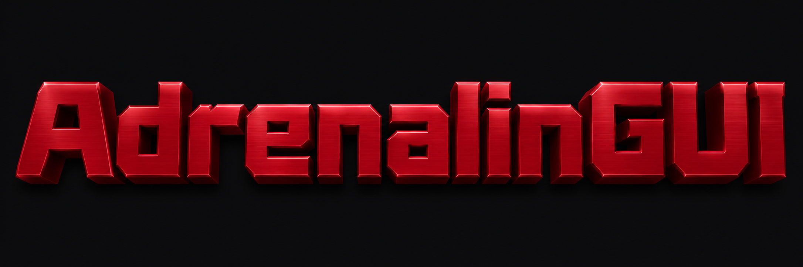
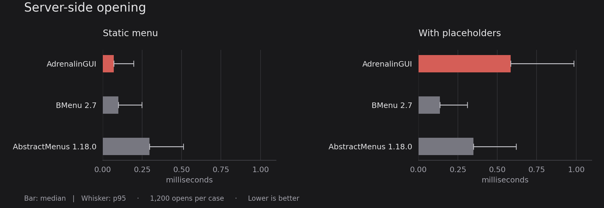
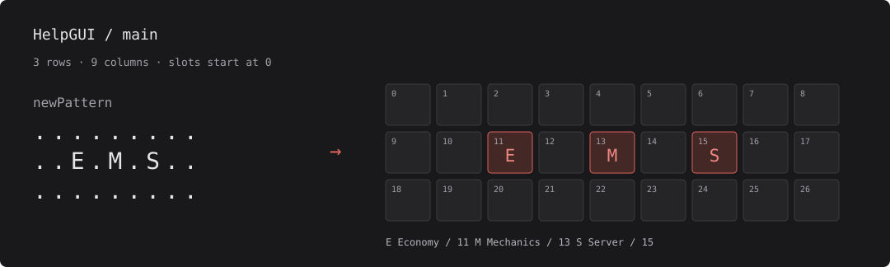

# AdrenalinGUI

Kotlin API для инвентарных меню в Minecraft-плагинах

[English](README.md) · [Русский](README.ru.md)



## Меню рядом с логикой вашего плагина

Задайте расположение символами, добавьте предметы и обработайте клики на Kotlin. Для обычного окна есть `SingleGUISurface`, для справки с категориями — `MultiGUISurface`: все разделы остаются в одном классе.

- **Понятный шаблон** — девять символов в строке, повторяющиеся символы заполняют несколько слотов.
- **Необязательный PlaceholderAPI** — значения текущего игрока в заголовке, названии и описании, подстановка при каждом открытии.
- **MiniMessage везде** — теги, HEX и градиенты в заголовках, названиях и описаниях.
- **Именованные страницы** — `page("economy")` и `openPage("economy")`, отдельный кэш каждой страницы.
- **События жизненного цикла** — `onOpen` и `onClose` для каждого успешно открытого окна.
- **Кэш прототипов** — шаблон и метаданные предметов собираются один раз; игроки получают отдельные инвентари и копии предметов.
- **Вызовы вашего API** — обработчики кнопок могут обращаться к сервисам плагина напрямую на Kotlin.

AdrenalinGUI устанавливается отдельным плагином. Публичная сборка использует Paper/Adventure напрямую, Kotlin runtime включён в JAR.

## Требования

| Компонент | Требование |
| --- | --- |
| Java | 21 |
| Сервер | Paper 1.21.11 или совместимый по API форк; целевое ядро разработки — UniverseSpigot |
| Компилятор Kotlin | В проекте 2.5.0-Beta2; используйте эту версию или совместимый компилятор |
| Сборка | Gradle Wrapper 9.6.0 уже включён |
| Дополнительные плагины | Не требуются; PlaceholderAPI, Vault с экономическим провайдером и LuckPerms устанавливаются по желанию |
| Folia | Текущий планировщик основного потока не поддерживает Folia |

Сборка, модульные тесты и локальный ботстенд проверяют описанные ниже сценарии. Это не тест вместимости сервера. Совместимость с версиями вне целевой не заявляется.

## Сборка и установка

Готовый JAR плагина доступен в [GitHub Releases](https://github.com/chotaktota/AdrenalinGUI/releases). При отправке тега вида `v1.0.0` GitHub собирает проект на Java 21, запускает тесты и публикует JAR с версией из тега.

```bash
git clone https://github.com/chotaktota/AdrenalinGUI.git
cd AdrenalinGUI
./gradlew clean build publishToMavenLocal
```

На Windows:

```powershell
.\gradlew.bat clean build publishToMavenLocal
```

Положите `build/libs/AdrenalinGUI-1.0-SNAPSHOT.jar` в папку `plugins/` сервера и перезапустите сервер.

В `build.gradle.kts` своего плагина:

```kotlin
repositories {
    mavenLocal()
}

dependencies {
    compileOnly("dev.aethereal:AdrenalinGUI:1.0-SNAPSHOT")
}
```

Координаты относятся к артефакту, опубликованному предыдущей командой в локальный Maven. Отдельный Maven-репозиторий и релиз через JitPack пока не настроены.

В `plugin.yml` своего плагина:

```yaml
depend: [AdrenalinGUI]
```

Если используется `paper-plugin.yml`:

```yaml
dependencies:
  server:
    AdrenalinGUI:
      load: BEFORE
      required: true
      join-classpath: true
```

## Первое меню

```kotlin
import dev.aethereal.agui.surface.SingleGUISurface
import org.bukkit.Material
import org.bukkit.plugin.java.JavaPlugin

class MainGUI(plugin: JavaPlugin) : SingleGUISurface(3, plugin) {
    override fun onUpdateNodes() {
        with(newPattern("""
            .........
            ....X....
            .........
        """.trimIndent())) {
            title("<red>Главное меню")
            iconAt(pos('X')) {
                type(Material.ENDER_EYE)
                name("<white>Око Эндера")
                loreLine("<gray>Ваше меню. Ваш код на Kotlin.")
                loreLine("<green>Нажмите, чтобы закрыть")
                glow()
                allFlags()
                onClick { close() }
            }
        }
    }
}
```

Создайте экземпляр один раз в своём плагине и переиспользуйте:

```kotlin
val menu = MainGUI(this)
menu.open(player)
```

В шаблоне должно быть указанное число строк, в каждой — ровно девять символов. Точка обозначает пустой слот. `pos('X')` возвращает все слоты с символом `X`; `iconAt(13)` задаёт слот по индексу с нуля.

## Одно меню, несколько страниц

```kotlin
import dev.aethereal.agui.surface.MultiGUISurface
import org.bukkit.Material
import org.bukkit.plugin.java.JavaPlugin

class GuideGUI(plugin: JavaPlugin) : MultiGUISurface(1, plugin) {
    override fun onUpdateNodes() {
        page("main") {
            with(newPattern("....E....")) {
                title("<gold>Помощь")
                iconAt(pos('E')) {
                    type(Material.GOLD_INGOT)
                    name("<yellow>Экономика")
                    onClick { openPage("economy") }
                }
            }
        }
        page("economy") {
            with(newPattern("....B....")) {
                title("<yellow>Экономика")
                iconAt(pos('B')) {
                    type(Material.ARROW)
                    name("<yellow>Назад")
                    onClick { openPage("main") }
                }
            }
        }
    }
}
```

`menu.open(player)` открывает `main`, а `menu.open(player, "economy")` — конкретный раздел. Начальную страницу можно изменить третьим аргументом конструктора. Размер отдельной страницы: `page("economy", rows = 6)`.

В полном примере [HelpGUI](src/test/kotlin/dev/aethereal/agui/example/HelpGUI.kt) есть четыре страницы: главная, экономика, механики и информация о сервере.

## PlaceholderAPI

Установите PlaceholderAPI и расширения, нужные вашим плейсхолдерам. Без него меню продолжают работать, а токены остаются текстом. При отсутствии нужного расширения неизвестный плейсхолдер также остаётся без замены.

```kotlin
title("<gold>Профиль %player_name%")
name("<white>%player_name%")
loreLine("<gray>Баланс: <yellow>%vault_eco_balance%")
```

Вызовы используются в блоке заголовка и предмета, как в примерах выше. Полный пример [PlayerProfileGUI](src/test/kotlin/dev/aethereal/agui/example/PlayerProfileGUI.kt) компилируется вместе с проектом.

Подстановка выполняется на основном потоке для игрока, открывающего меню, перед разбором MiniMessage. MM-теги из значений плейсхолдеров тоже форматируются; legacy-коды цветов также поддерживаются, в том числе в значениях расширений. Значения плейсхолдеров читаются заново; ограниченный общий кэш переиспользует компоненты с одинаковым итоговым текстом. Одинаковая исходная строка вычисляется один раз в пределах одного открытия, а статический текст использует готовый компонент.

Значения обновляются при повторном открытии меню или страницы. Уже открытый инвентарь автоматически не обновляется. Требования к расширениям описаны в [документации PlaceholderAPI](https://wiki.placeholderapi.com/developers/using-placeholderapi/).

## Регистрация и открытие по имени

```kotlin
import dev.aethereal.agui.AdrenalinGUI
import org.bukkit.plugin.java.JavaPlugin

val engine = JavaPlugin.getPlugin(AdrenalinGUI::class.java).engine
engine.menus.register("help", HelpGUI(this))
engine.open("help", player)
```

Регистрация необязательна: можно вызывать `open` сохранённого экземпляра напрямую. `engine.menus.find("help")` возвращает меню или null, `unregister("help")` удаляет имя и очищает кэш. Уже открытые окна продолжают работать до закрытия.

[HelpExamplePlugin.kt](src/test/kotlin/dev/aethereal/agui/example/HelpExamplePlugin.kt) показывает подключение команды. Для него нужен такой дескриптор:

```yaml
name: HelpExample
version: '1.0'
main: dev.aethereal.agui.example.HelpExamplePlugin
api-version: '1.21.11'
depend: [AdrenalinGUI]
commands:
  helpui:
    description: Открыть справку сервера
```

Классы примеров компилируются при тестировании и не входят в JAR фреймворка.

## События, клики и кэш

В `SingleGUISurface` переопределяются `onOpen(player: Player)` и `onClose(player: Player)`. В `MultiGUISurface` — `onOpen(player: Player, page: String)` и `onClose(player: Player, page: String)`.

При переходе сначала вызывается закрытие старой страницы, затем открытие новой — если она успешно открылась. Отменённое открытие не вызывает обработчики новой страницы. Если Bukkit уже закрыл предыдущее окно, а другой плагин отменил новое открытие, предыдущее окно не восстанавливается.

| Действие | Поведение |
| --- | --- |
| Первое открытие | Собираются шаблон, текст и прототипы предметов |
| Повторное открытие | Копируются прототипы, текст с плейсхолдерами подставляется для текущего игрока |
| `menu.invalidateCache()` | Пересборка при следующем открытии; текущие окна сохраняют содержимое |
| `multi.invalidateCache("economy")` | Сбрасывается только указанная страница |
| Отключение плагина-владельца | Закрываются сессии, удаляются регистрации и очищаются учтённые кэши |

Переиспользуйте экземпляры меню. Новый объект на каждый клик означает новый кэш. Кэшированный шаблон общий для зрителей: не захватывайте в нём персональные данные конкретного игрока. Текстовые плейсхолдеры вычисляются отдельно для каждого игрока при открытии.

В `onClick` доступны `player`, `slot`, `click`, `isLeftClick`, `isRightClick`, `isShiftClick`, а у многостраничного меню ещё и `page`. Обработчик запускается на следующем тике основного потока; переход в другое меню из кнопки безопасен. Дополнительные клики до запуска объединяются, а закрытие окна отменяет отложенное действие.

Перемещение предметов и drag блокируются в обоих инвентарях. Операции меню выполняются на основном потоке. Если другое меню нужно открыть из `onClose`, запланируйте открытие на следующий тик.

Периодических задач обновления и автоматического перебора игроков нет. Это описание реализации, а не утверждение о превосходстве по скорости.

## BMenu и AbstractMenus

Ниже — конкретные отличия API проверенных релизов. Это не утверждение, что похожее меню нельзя написать через API другого плагина.

| Что AdrenalinGUI предоставляет сразу | BMenu 2.7 | AbstractMenus 1.18.0 |
| --- | --- | --- |
| Kotlin DSL с получателями: `SingleGUISurface`, `newPattern`, `iconAt`, `onClick` | Java API и YAML; такого готового Kotlin DSL нет | Java API и HOCON; такого готового Kotlin DSL нет |
| Именованные страницы и `openPage` в одном классе `MultiGUISurface` | Аналогичного готового DSL поверхностей и страниц нет | Аналогичного готового DSL поверхностей и страниц нет |
| Событийный движок без повторяющейся задачи обновления меню | Загрузчик меню запускает задачу каждого тика | Менеджер меню запускает задачу обновления |

Практическое отличие — расположение предметов, переходы между страницами и типизированные вызовы сервисов остаются в одном Kotlin-классе. Для обычной кнопки не нужно регистрировать собственное действие конфига или сериализатор. Переходы, API расширения, плейсхолдеры и кэши есть у конкурентов — это не уникальные возможности AdrenalinGUI.

Проверены [исходники BMenu 2.7](https://github.com/By1337/BMenu/tree/2.7/src/main/java/dev/by1337/bmenu) и [AbstractMenus 1.18.0](https://github.com/AbstractMenus/minecraft-plugin/tree/v1.18.0/src/main/java/ru/abstractmenus). Текущие ветки разработки могут отличаться. Базовый AdrenalinGUI также не требует дополнительных серверных плагинов; BMenu нужны BLib и PlaceholderAPI, а интеграции AbstractMenus необязательны.

## Замеры производительности

Таблицы ниже относятся к версии **до оптимизации плейсхолдеров**. Текущий кэш описан в разделе динамических иконок.

Замер от 20 ноября 2026 года: Paper 1.21.11 build 132, Java 21.0.11, i5-12400F, 16 ГБ RAM, Windows 11, heap JVM 1–2 ГБ. Восемь ботов работали на том же ПК. Все три плагина были загружены на одном сервере и проверялись последовательно с изменением порядка.

Окно: 54 предмета PAPER, четыре строки описания, одинаковые legacy-цвета. Второй сценарий добавлял плейсхолдеры игрока в заголовок, названия и описание. После прогрева выполнены три раунда: **по 1 200 открытий и 1 200 действий на движок в каждом сценарии**. Вместе с прогревом боты проверили 466 560 предметов.

### Открытие на стороне сервера

Время от вызова публичного API открытия до возврата, включая замену старого окна. Сеть и отрисовка клиента не входят. Меньше — лучше.

| Движок | Статика: p50 / p95, мс | Плейсхолдеры: p50 / p95, мс |
| --- | ---: | ---: |
| AdrenalinGUI | 0.070 / 0.197 | 0.586 / 0.985 |
| BMenu 2.7 | 0.100 / 0.247 | 0.136 / 0.310 |
| AbstractMenus 1.18.0 | 0.297 / 0.512 | 0.348 / 0.620 |



### Задержка действия кнопки

От получения клика сервером до выполнения одинаковой команды от имени игрока. Включает планирование обработчика, но не сетевую задержку клиента.

| Движок | Статика: p50 / p95, мс | Плейсхолдеры: p50 / p95, мс |
| --- | ---: | ---: |
| AdrenalinGUI | 25.287 / 49.034 | 25.190 / 48.874 |
| BMenu 2.7 | 0.021 / 0.068 | 0.025 / 0.084 |
| AbstractMenus 1.18.0 | 0.025 / 0.094 | 0.023 / 0.064 |

В этом прогоне у AdrenalinGUI самая низкая медиана для статического меню, но с плейсхолдерами он медленнее обоих конкурентов. Перенос его обработчика на следующий тик также дал около 25 мс медианной задержки действия; два других движка выполнили проверяемое действие внутри события клика. Общего утверждения «самый быстрый» здесь нет.

Это один прогон на рабочем ПК, не тест предельной вместимости или TPS. Между раундами время менялось. HTTP(S)-загрузки и проверки обновлений JVM были заблокированы; необязательный мост BMenu 1.7 был недоступен, нативный путь 2.7 проверен. Подробности: [методика и повторение теста](benchmarks/README.md), [сырые замеры](benchmarks/results/2026-11-20/samples.json), [статистика по раундам](benchmarks/results/2026-11-20/summary.json), [окружение](benchmarks/results/2026-11-20/environment.json).

### После оптимизации: приблизительный замер под Rust

Второй прогон выполнен с запущенным Rust (около 8 ГБ памяти). Те же меню, восемь ботов и по 1 200 открытий на сценарий; все 7 200 действий записаны. Все проверки 466 560 предметов прошли. Это ориентир под сторонней нагрузкой, а не чистое сравнение с исходной сборкой.

| Движок | Статика: p50 / p95, мс | Плейсхолдеры: p50 / p95, мс |
| --- | ---: | ---: |
| AdrenalinGUI | 0.158 / 0.414 | 0.217 / 0.559 |
| BMenu 2.7 | 0.177 / 0.441 | 0.206 / 0.597 |
| AbstractMenus 1.18.0 | 0.501 / 0.989 | 0.578 / 1.151 |

По медиане плейсхолдерного сценария BMenu остаётся немного быстрее; p95 у AdrenalinGUI ниже. Разница медиан около 5% на загруженном ПК не доказывает устойчивого преимущества. Задержка клика AdrenalinGUI остаётся около 25 мс из-за безопасного переноса обработчика на следующий тик.

[Сырые результаты](benchmarks/results/2026-11-20-loaded-v2/samples.json), [статистика](benchmarks/results/2026-11-20-loaded-v2/summary.json), [условия и SHA-256](benchmarks/results/2026-11-20-loaded-v2/environment.json). Для итогового сравнения нужен повтор без игры.

## Примеры



| Пример | Что показывает |
| --- | --- |
| [QuickStartGUI](src/test/kotlin/dev/aethereal/agui/example/QuickStartGUI.kt) | Простое меню по шаблону |
| [HelpGUI](src/test/kotlin/dev/aethereal/agui/example/HelpGUI.kt) | Четыре страницы и возврат к категориям |
| [HelpExamplePlugin](src/test/kotlin/dev/aethereal/agui/example/HelpExamplePlugin.kt) | Регистрацию и команду игрока |
| [PreviewGUI](src/test/kotlin/dev/aethereal/agui/example/PreviewGUI.kt) | Большой шаблон на шесть строк |
| [DynamicEconomyGUI](src/test/kotlin/dev/aethereal/agui/example/DynamicEconomyGUI.kt) | Динамические поля, refresh и сервисы экономики/прав |

## Структура

```text
AdrenalinGUI.kt
engine/
  MenuEngine.kt
  MenuRegistry.kt
  MenuScheduler.kt
  cache/
  session/
surface/
  GUISurface.kt
  SingleGUISurface.kt
  MultiGUISurface.kt
  layout/
    Pattern.kt
    page/
  item/
    Icon.kt
    DynamicIcon.kt
    InputField.kt
    builder/
    click/
      GUIClick.kt
      action/
        ItemAction.kt
        PlayerAction.kt
        OtherAction.kt
  animation/
command/
text/
listener/
```

## Что реализовано, а что дальше

Сейчас работают инвентарные меню Java, именованные страницы, MiniMessage/legacy, PlaceholderAPI, динамические иконки с явным refresh, анимации по тикам, экономика Vault, LuckPerms, обработчики кликов и события открытия/закрытия.


Автоматическое разбиение списков по страницам, периодические обновления значений, загрузчики конфигов, нативные Bedrock-формы и определение ресурспака/клиента пока не реализованы.

`./gradlew test` запускает модульные тесты кэша, шаблонов, реестра страниц и жизненного цикла. Примеры также компилируются; описанные сценарии на живом сервере дополнительно проверены ботстендом.

## Обратная связь

Создайте [issue](https://github.com/chotaktota/AdrenalinGUI/issues), укажите Java, версию сервера, минимальный класс меню и шаги воспроизведения.

[English documentation →](README.md)

## MiniMessage и legacy вместе

Заголовки, названия, описания и значения плейсхолдеров поддерживают смешанный MiniMessage и legacy. Форматы: `&a`, `§a`, `&l`, `&r`, `&#A1B2C3`, `&x&A&1&B&2&C&3` и аналоги с символом §. Legacy-цвет сбрасывает предыдущие украшения, как в обычном legacy. Содержимое атрибутов MM-тегов, например URL, не преобразуется.

```kotlin
title("&6Помощь <bold>сервера</bold>")
name("&#55FFAA%player_name%")
loreLine("§7Баланс: &e%vault_eco_balance%")
```

[Оформление и источники изображений](docs/assets/README.md)

## Шаблоны иконок, ввод в чат и «Назад»

```kotlin
with(newPattern("XYIB.....")) {
    val warp = template("warpTemplate", Material::class.java, String::class.java) { material, label ->
        type(material)
        name(label)
        loreLine("<gray>ЛКМ — выбрать")
        allFlags()
    }

    iconAt(pos('X'), warp, Material.ENDER_PEARL, "<green>Спавн")
    iconAt(pos('Y'), warp, Material.COMPASS, "<gold>Рынок")

    iconAt(pos('I')) {
        type(Material.PAPER)
        onClick {
            inputChat("Введите кол-во монет в чат:", Int::class.java) {
                validate { it > 0 }
                onSuccess { amount -> sendMessage("Введено: $amount") }
                onFailure { reason -> sendMessage("Ошибка ввода: $reason") }
            }
        }
    }

    iconAt(pos('B')) {
        type(Material.ARROW)
        name("<yellow>Назад")
        visibleIf(engine::hasPreviousMenu)
        back()
    }
}
```

Именованные шаблоны действуют в текущем паттерне. Два аргумента можно передать в шаблон напрямую. Компилятор проверит их типы и порядок. Если полей больше, их можно передать одним объектом. Если у иконки есть собственный блок, он выполняется после шаблона и может переопределить его настройки.

Есть и сокращённая форма `inputChat<Int>("Введите сумму:") { ... }`. Ввод закрывает окно и перехватывает сообщение игрока до отправки в общий чат. Обработчики выполняются на основном потоке. Поддерживаются `String`, `Int`, `Long`, `Float`, `Double` и `Boolean`. Время ожидания по умолчанию — 1200 тиков. Для отмены введите `отмена` или `cancel`. В `onFailure` приходят `INVALID_INPUT`, `CANCELLED` или `TIMEOUT`. Неверный ответ вызывает обработчик ошибки и завершает ввод. Выход игрока, открытие другого инвентаря и отключение плагина-владельца прекращают ожидание.

В блоке иконки `back()` назначает готовое действие возврата. Внутри `onClick` метод `hasPreviousMenu()` проверяет наличие предыдущего меню, а `back()` возвращает к нему. У движка также есть `hasPreviousMenu(player)` и `back(player)`. История хранит до 32 переходов между меню и страницами. Закрытие окна завершает эту историю.

## Инвентарь игрока

В `onClick` действия доступны напрямую: `countItem`, `hasItem`, `giveItem` и `takeItem`. В остальных обработчиках на основном потоке используйте `ItemAction(player)` из пакета `dev.aethereal.agui.surface.item.click.action`.

```kotlin
onClick {
    val count = countItem(Material.DIAMOND)
    if (takeItem(Material.DIAMOND, 3)) {
        player.sendMessage("Списано 3 алмаза из $count")
    }
    if (!giveItem(Material.EMERALD, 20)) {
        player.sendMessage("В инвентаре не хватает места для изумрудов")
    }
}
```

`countItem`, `hasItem` и `takeItem` принимают `Material` или `ItemStack`. При передаче `ItemStack` сравниваются тип и метаданные. Количество в стаке задаёт значение по умолчанию для `hasItem` и `takeItem`.

`freeInventorySlots()` возвращает число пустых слотов, `isInventoryFull()` проверяет, заняты ли все слоты. `spaceForItem(stack)` и `canFitItem(stack, amount)` учитывают место в совместимых стаках. `giveItem` и `takeItem` выдают или списывают всё количество целиком. При результате `false` инвентарь остаётся как был. Методы работают с основным инвентарём и хотбаром. Броня и вторая рука в расчёт не входят.

## Свойства предметов

```kotlin
iconAt(0) {
    type(Material.DIAMOND_SWORD)
    enchant(Enchantment.SHARPNESS, 5)
    attribute(Attribute.ATTACK_DAMAGE, NamespacedKey(plugin, "bonus"), 2.0,
        slot = EquipmentSlotGroup.MAINHAND)
    modelData(1201)
    nbt(NamespacedKey(plugin, "item_id"), PersistentDataType.STRING, "reward_sword")
    unbreakable()
}
iconAt(1) {
    type(Material.POTION)
    potionColor(Color.fromRGB(0xE64049))
}
iconAt(2) {
    type(Material.PLAYER_HEAD)
    headTexture(textureHash)
    equippable(EquipmentSlot.HEAD) {
        model = NamespacedKey(plugin, "reward_hat")
    }
}
```

`plugin` — экземпляр вашего плагина, `textureHash` — хеш текстуры Minecraft. `headTexture` также принимает ссылку textures.minecraft.net или Base64 из свойства textures. В `modelData { ... }` можно задавать числа, флаги, строки и цвета. `itemModel(key)` задаёт модель предмета из ресурспака. `equippable` настраивает слот и компонент экипировки, включая её модель. Для содержимого зелий есть `potionType` и `potionEffect`.

`nbt` записывает типизированные данные с пространством имён в PersistentDataContainer предмета. Читайте их по тому же ключу и типу. Передайте `null`, чтобы удалить значение. Остальные свойства предмета доступны через `meta { ... }` или `meta(PotionMeta::class.java) { ... }`. Те же методы работают внутри `dynamic` и анимационного `change`.

## Видимость иконок по условию

```kotlin
iconAt(pos('V')) {
    type(Material.DIAMOND)
    name("<gold>VIP")
    requirePermission("myplugin.vip")
    onClick { close() }
}
```

Для своего условия используйте `visibleIf { player -> ... }`. Если у иконки несколько условий, должны выполниться все. Видимость проверяется отдельно для каждого игрока при открытии меню, при refresh и когда анимация обновляет слот. Чтобы обновить уже открытое окно после изменения прав, вызовите `engine.refresh(player)`. Клик работает только по отображённой иконке, а перед запуском обработчика условия проверяются ещё раз.

## Динамические иконки и refresh

```kotlin
iconAt(pos('B')) {
    type(Material.PAPER)
    name("<gold>Счёт")
    dynamic { player ->
        val balance = engine.economy.balance(player)
        name("<gold>${engine.economy.format(balance)}")
        lore("&7Игрок: %player_name%", "<gray>Доступно: $balance")
        glow(balance >= 100.0)
        if (balance >= 100.0) enchant(Enchantment.UNBREAKING, 1)
    }
    onClick {
        val result = withdraw(100.0)
        if (result.success) engine.refresh(player, slot)
    }
}
```

В примере `engine` — `AdrenalinGUI.engine`. Импорты: `org.bukkit.Material`, `org.bukkit.enchantments.Enchantment`.
`dynamic` вызывается на основном потоке при открытии и явном обновлении. Он получает текущего игрока и отдельную копию прототипа. `lore(...)` заменяет описание полностью; `name`, `glow`, `enchant` и `removeEnchant` меняют только этот предмет. При следующем обновлении изменения снова применяются к исходному прототипу: старые зачарования и строки не накапливаются.

`engine.refresh(player)` обновляет все предметы текущего окна, `engine.refresh(player, 11, 13)` — выбранные слоты, начиная с нуля. Внутри `onClick` можно вызвать `refresh()` или `refresh(slot)`. Заголовок, страницу и события открытия/закрытия refresh не меняет. Для нового заголовка откройте меню заново. Таймеров и перебора игроков нет; после изменения параметров вызывайте refresh сами.

Плейсхолдеры вычисляются заново для каждого открытия/refresh; одинаковый токен внутри одного такого прохода вычисляется один раз. До 16 вариантов результата MiniMessage и метаданных сохраняются на элемент меню. Кэш проверяется по актуальному результату, поэтому изменение баланса, имени или прав не требует `invalidateCache()`. Кэш предметов не сохраняет результаты `dynamic`. Дорогие запросы к БД сначала выполняйте через свой сервис асинхронно, а готовые значения передавайте в меню на основном потоке.

## Vault и LuckPerms

Интеграции необязательны: установите Vault с экономическим провайдером и/или LuckPerms. Они не включаются в JAR AdrenalinGUI. Плейсхолдеры этих плагинов по-прежнему требуют PlaceholderAPI и соответствующих расширений.

```kotlin
val money = engine.economy
val balance = money.balance(player)
val affordable = money.has(player, 100.0)
val payment = money.withdraw(player, 100.0)
if (payment.success) {
    engine.refresh(player)
}
val refund = money.deposit(player, 100.0)
val formatted = money.format(balance)

val rights = engine.permissions
val allowed = rights.hasPermission(player, "shop.vip") == true
val group = rights.primaryGroup(player.uniqueId)
val groups = rights.groups(player)
val prefix = rights.prefix(player)
val suffix = rights.suffix(player)
val saved = rights.setPermission(player.uniqueId, "shop.vip", duration = Duration.ofDays(7))
rights.unsetPermission(player.uniqueId, "shop.old")
rights.addGroup(player.uniqueId, "vip", duration = Duration.ofDays(7))
rights.removeGroup(player.uniqueId, "old")
```

`Duration` — `java.time.Duration`. Суммы должны быть конечными и неотрицательными. Проверяйте `Transaction.success`, а не только предварительный `hasItem`: провайдер может отклонить операцию. Доступ без установленного API/провайдера завершается диагностической ошибкой.

Изменения LuckPerms возвращают `CompletableFuture<Void>`; не вызывайте `join()`/`get()` на основном потоке. Проверяйте ошибку завершения, а refresh, выдачу предметов и другие Bukkit-вызовы из continuation планируйте через основной поток. Операции меняют только указанные глобальные узлы, сохраняя контекстные права. Снятие собственного узла не отменяет права, унаследованные от группы. Валидность группы и бизнес-правила покупки проверяет ваш плагин; списание и асинхронная выдача группы не являются общей транзакцией.

API исходных интеграций: [Vault Economy](https://github.com/MilkBowl/VaultAPI/blob/master/src/main/java/net/milkbowl/vault/economy/Economy.java), [LuckPerms UserManager](https://github.com/LuckPerms/LuckPerms/blob/master/api/src/main/java/net/luckperms/api/model/user/UserManager.java). Для прямого использования `permissions.api`, `user` или `loadUser` добавьте compileOnly `net.luckperms:api:5.4` в свой плагин.

## Анимация по тикам

Внутри `with(newPattern(...))` задайте одну временную шкалу:

```kotlin
animation {
    at(0) { hide(pos('X')) }
    at(10) { show(pos('X')) }
    at(20) {
        change(pos('X')) { player ->
            name("<gold>${player.name}")
            lore("&7Баланс: %vault_eco_balance%")
            glow()
        }
    }
    at(30) {
        set(pos('X')) {
            type(Material.EMERALD)
            name("<green>Готово")
            onClick { close() }
        }
    }
    loop(60)
}
```

`at(10)` означает десятый серверный тик после открытия, а не задержку относительно предыдущего шага. При 20 TPS это около половины секунды; при просадках TPS реальное время увеличивается. Шаг 0 выполняется сразу после `onOpen`; остальные шаги идут по планировщику основного потока. Несколько `at` на одном тике объединяются в порядке объявления.

- `set(slot)` / `set(pos('X'))` устанавливает новую иконку с обычным DSL, включая `dynamic` и `onClick`. Предмет становится видимым, предыдущие изменения `change` сбрасываются.
- `hide(...)` скрывает предмет вместе с его обработчиком клика, сохраняя иконку.
- `show(...)` возвращает последнюю установленную иконку с её изменениями и актуальными плейсхолдерами.
- `change(...) { player -> ... }` меняет имя, лор, блеск и зачарования текущей иконки. Материал заменяйте через `set`. Для пустого слота change ничего не делает.

Без `loop` анимация проигрывается один раз, и последний кадр остаётся в меню. `loop(60)` повторяет шкалу каждые 60 тиков; период обязан быть больше последнего тика. Например, шаг 10 следующего цикла выполнится на тике 70. Между циклами состояние автоматически не сбрасывается: если нужен исходный предмет, установите его через `set` в шаге 0.

`refresh` сохраняет установленные иконки, скрытые слоты и изменения анимации. Сохранённые `change` повторно применяются при refresh, поэтому внутри них не выполняйте покупки и другие действия с побочными эффектами. Текст поддерживает MiniMessage, legacy и PlaceholderAPI. Состояние и прогресс отдельные для каждого открытого окна; общий кэш не меняется.

На весь движок приходится не более одного ожидающего вызова планировщика. Очередь хранит ближайшие действия окон и кликов; когда она пуста, фоновых задач нет. Обновляются только затронутые слоты, неизменившиеся предметы повторно не устанавливаются. Анимация не перебирает онлайн-игроков. Закрытие окна, переход на другую страницу, выход игрока и отключение плагина отменяют ожидающую задачу. Исключение в шаге закрывает окно с диагностикой. Клик, отложенный до изменения того же слота, отменяется, чтобы не выполнить действие уже заменённого или скрытого предмета.

Полный компилируемый пример: [AnimatedGUI](src/test/kotlin/dev/aethereal/agui/example/AnimatedGUI.kt). Приведённые выше замеры скорости относятся к сборкам до добавления анимаций, а не к стоимости проигрывания кадров.

## Команда /guis info

Команда доступна с правом `adrenalingui.admin` (по умолчанию у операторов).

| Команда | Действие |
| --- | --- |
| `/guis` | Показать подсказку |
| `/guis info` | Вывести первые 10 зарегистрированных меню с названием плагина-владельца и типом |
| `/guis info --page <номер>` | Показать другую страницу списка |
| `/guis info <меню>` | Вывести владельца и его версию, состояние плагина, тип, класс и размер меню |

Для многостраничного меню также выводится начальная страница. Окон команда не открывает, кэши не сбрасывает и шаблоны не строит. В список попадают только регистрации `engine.menus.register(id, menu)`. Названия поддерживают табуляцию; для команд используйте идентификаторы без пробелов. Команда доступна и из консоли.

`engine.menus.entries()` возвращает отдельный снимок реестра. Изменение снимка не меняет регистрации; обращаться к нему нужно на основном потоке.

## Изменение пакетов

MenuEngine и MenuRegistry перенесены в `dev.aethereal.agui.engine`. При явном использовании типов DSL обновите импорты по дереву пакетов.

### Поля для предметов и задержка клика

`inputAt(pos('X'))` разрешает помещать предметы в отмеченные слоты. Поддерживаются обычный перенос, shift-клик, клавиши хотбара и перетаскивание по разрешённым слотам. Сбор предметов двойным кликом заблокирован. Поля не могут пересекаться с иконками и анимацией. При refresh содержимое полей сохраняется.

`inputItem(slot)` в обработчике клика возвращает копию предмета. `takeInput(slot)` извлекает предмет из поля и передаёт его обработчику. Извлечённым предметом распоряжается обработчик. Остальные предметы возвращаются при закрытии, переходе страницы и выходе игрока. При нехватке места остаток выпадает возле игрока с владельцем.

`cooldown(10)` внутри `iconAt` задаёт задержку в 10 серверных тиков между выполнениями обработчика. Задержка действует на игрока и объявленную иконку в текущей сессии, включая все слоты одной иконки. При открытии новой сессии задержка начинается заново. Таймеры для отсчёта не создаются.

```kotlin
inputAt(pos('X'))
iconAt(pos('B')) {
    type(Material.ANVIL)
    name("<red>Обработать предмет")
    cooldown(10)
    onClick {
        val slot = pos('X').first()
        val item = inputItem(slot)
        if (item != null) {
            player.sendMessage("В поле ${item.amount} предметов")
        }
    }
}
```

### Поле с барьером и отдельным слотом

```kotlin
inputAt(pos('S').first(), pos('T').first()) {
    placeholder {
        type(Material.BARRIER)
        name("<red>Поместите предмет")
        loreLine("<gray>ЛКМ — весь стак, ПКМ — один предмет")
    }
    loreLine("<yellow>Предмет выбран для улучшения")
}
```

В шаблоне `S` — место барьера, `T` — целевой слот. При переносе барьер скрывается. При полном извлечении предмета он появляется снова. ЛКМ переносит весь стак с курсора, ПКМ — один предмет. Режим можно закрепить через `transfer(InputTransfer.ALL)` или `transfer(InputTransfer.ONE)`. По умолчанию используется `InputTransfer.CLICK`.

Дополнительный лор отображается только внутри меню и проходит через MiniMessage, legacy и PlaceholderAPI. Исходное имя, лор и прочие метаданные сохраняются. `inputItem` и `takeInput` работают с целевым слотом и возвращают оригинал без дополнительного лора.

Из целевого слота предмет забирается ЛКМ, ПКМ или shift-кликом. Клавиши хотбара, выбрасывание и перетаскивание для связанных слотов заблокированы. Shift-клик из инвентаря игрока заполняет обычные поля, а связанное поле заполняется нажатием на барьер. При закрытии возвращается исходный предмет.


### Действия в onClick

Все действия вызываются напрямую. Реализации находятся в `surface/item/click/action`: `ItemAction` содержит работу с инвентарём, `PlayerAction` — экономику и права, `OtherAction` — ввод чата, переходы и поля меню.

```kotlin
onClick {
    val balance = balance()
    val diamonds = countItem(Material.DIAMOND)
    if (hasMoney(100.0)) {
        player.sendMessage("Баланс: $balance, алмазов: $diamonds")
    }
    inputChat<Int>("Введите количество") {
        validate { it > 0 }
        onSuccess { amount -> sendMessage("Вы ввели $amount") }
        onFailure { reason -> sendMessage("Ввод завершён: $reason") }
    }
}
```

Экономика доступна через `balance()`, `hasMoney(amount)`, `withdraw(amount)` и `deposit(amount)`. Списание и пополнение возвращают `PlayerAction.Transaction` с результатом операции.

`hasPermission(permission)` использует проверку прав игрока Bukkit. `setPermission`, `unsetPermission`, `addGroup`, `removeGroup`, `prefix()`, `suffix()` и `groups()` работают через LuckPerms. Изменения прав и групп возвращают `CompletableFuture`. Для Bukkit API из асинхронного продолжения нужно переключиться на основной поток.

За пределами обработчика используйте `engine.actions(player)` или `ItemAction(player)` на основном потоке. Удалённые отдельные типы `MenuEconomy`, `MenuPermissions`, `PlayerItems` и `ChatInput` заменены классами действий. Настройки ввода и причины завершения находятся в `OtherAction.Chat` и `OtherAction.InputFailure`.
